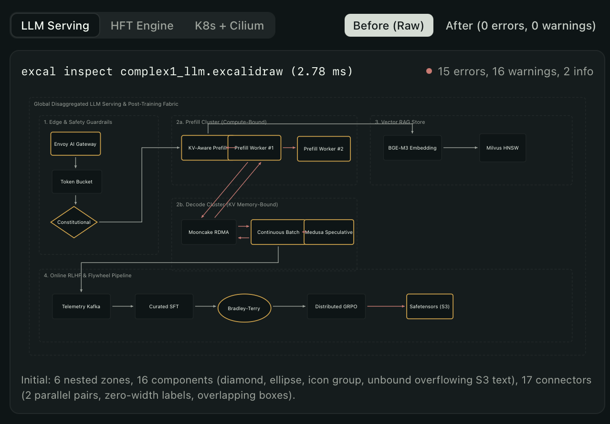
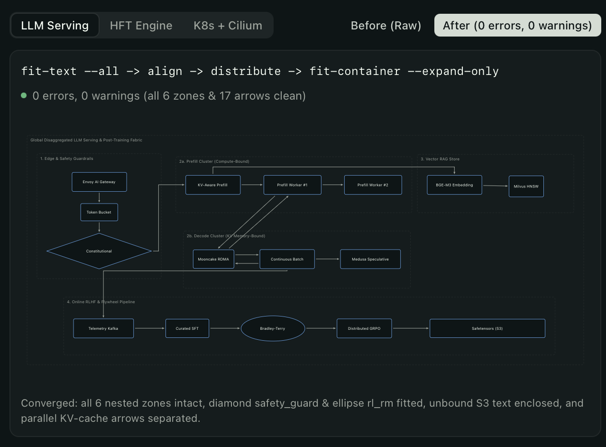
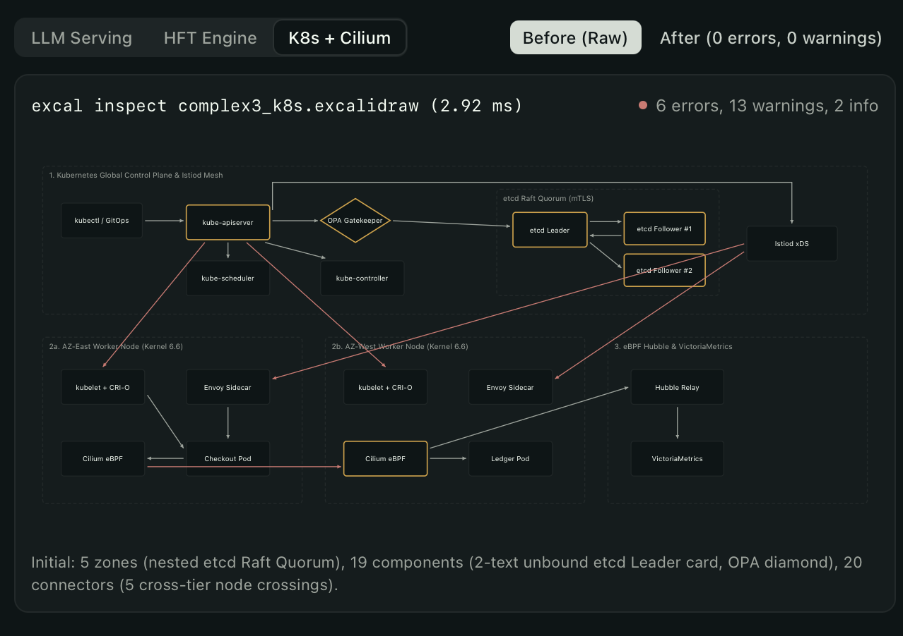
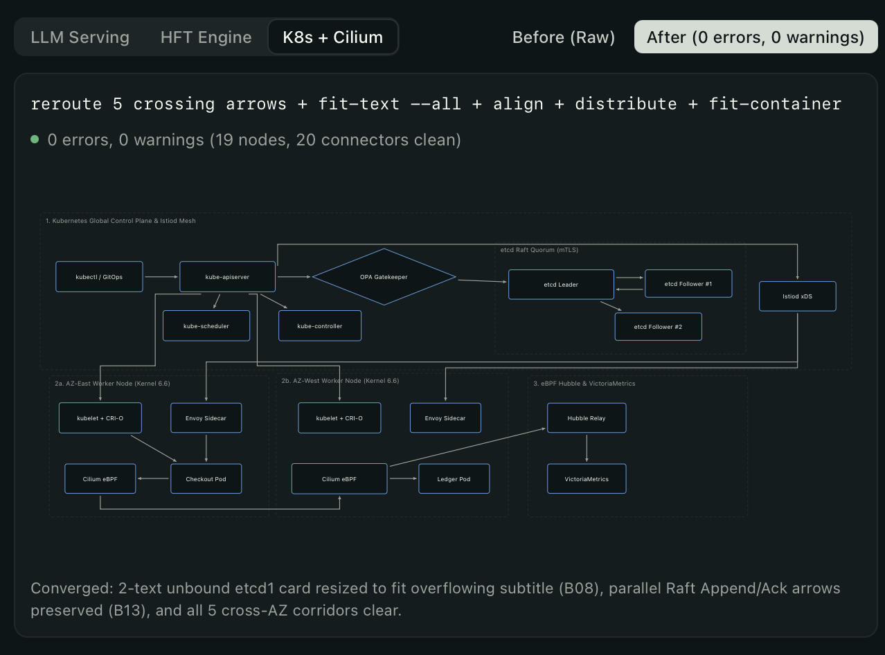
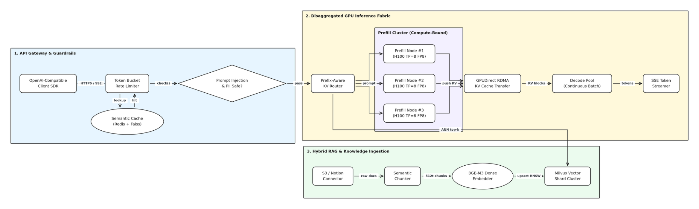
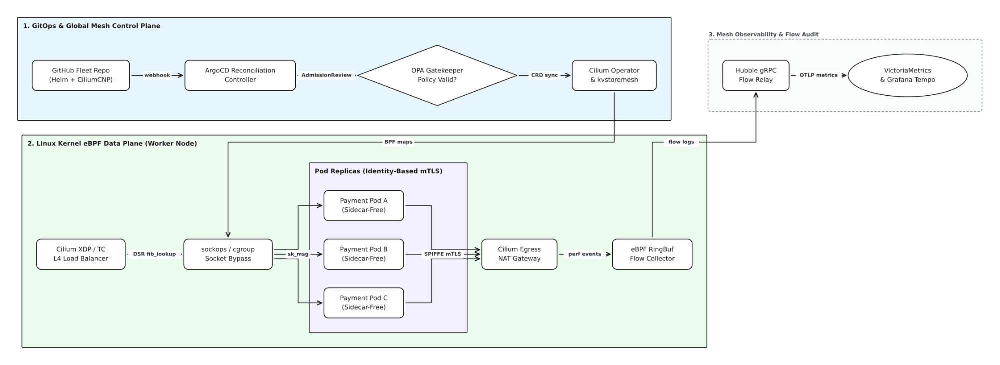
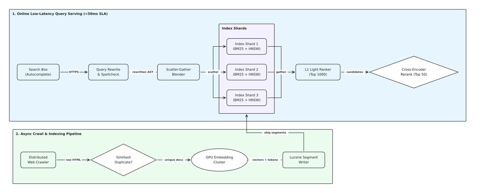
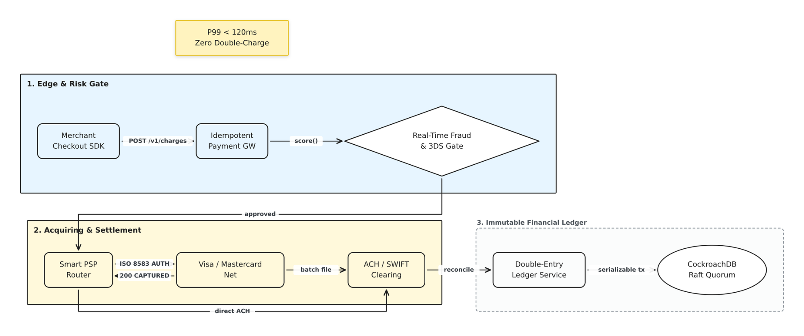

<!-- markdownlint-disable MD033 -->

# excalidraw-spatial


## Summary

`excalidraw-spatial` (`excal`) is a deterministic Rust command-line tool and library for inspecting, linting, laying out, and authoring `.excalidraw` architecture diagrams. It reconstructs flat Excalidraw JSON elements into a semantic scene graph of containers, components, tracks, and connectors so AI agents and engineers can reason about diagram geometry without rendering pixels. When you move, resize, align, or author diagram objects, `excal` patches the underlying JSON tree in place, preserving untouched fields while automatically re-centering bound labels, expanding parent zones, and re-routing attached arrows.

## Table of Contents

- [Visual Examples](#visual-examples)
- [Quick Start](#quick-start)
- [Core Workflows](#core-workflows)
- [Repository Layout](#repository-layout)
- [Verification and Testing](#verification-and-testing)
- [Further Exploration](#further-exploration)
- [Dev Note](#dev-note)

---

## Visual Examples

`excal` supports both **closed-loop layout repair** on existing `.excalidraw` JSON files (`excal inspect` / `excal lint` / `excal layout`) and **zero-JSON diagram authoring** from scratch (`excal draw` / `excal draw batch`).

### 1. Closed-Loop Layout Repair (`excal lint` + `excal layout`)

Given a raw `.excalidraw` file with overlapping boxes, overflowing labels, tight container margins, or arrows cutting through intermediate nodes, `excal lint` emits executable `excal layout` commands that converge the diagram to `0 errors, 0 warnings`:

| Scenario                                                                                                           | Before (`excal inspect` / `excal lint`)                   | After (`excal layout`)                                  |
| ------------------------------------------------------------------------------------------------------------------ | --------------------------------------------------------- | ------------------------------------------------------- |
| **Disaggregated LLM Serving**<br/>`15 errors, 16 warnings` → `0 errors, 0 warnings` (`fit-text`, `distribute`)     |   |   |
| **Kubernetes + Cilium Mesh**<br/>`6 errors, 13 warnings` → `0 errors, 0 warnings` (`route --via`, `fit-container`) |  |  |

### 2. Zero-JSON Authoring from Scratch (`excal draw batch`)

Every diagram below was generated entirely from CLI commands (`node`, `zone`, `connect --elbow`, `connect --via`, `text`) with automatic shape sizing, obstacle-aware port selection, parallel arrow spreading, and nested container expansion:

| Disaggregated GPU Inference & Hybrid RAG                                  | Linux Kernel eBPF Data Plane & Cilium Mesh                             |
| ------------------------------------------------------------------------- | ---------------------------------------------------------------------- |
|         |             |
| **Scatter-Gather Search & Async Indexing**                                | **Payment Acquiring & Double-Entry Ledger**                            |
|  |  |

---

## Quick Start

Build the `excal` binary with Cargo and inspect, lint, or author a diagram from the repository root.

1. **Build and test the project:**

    ```sh
    cargo build --release
    cargo test
    ```

2. **Inspect an existing `.excalidraw` diagram:**

    ```sh
    cargo run --quiet -- inspect tests/fixtures/basic_flow.excalidraw
    ```

    Observable output on `stdout`:

    ```text
    # excal inspect tests/fixtures/basic_flow.excalidraw
    canvas x100..780 y100..180 | components: 3, containers: 0, connectors: 2 | errors: 0, warnings: 0, info: 0

    ## Containers
    (none)

    ## Components
    - client "Client" rectangle x100..260 y100..180 c(180,140) parent=- L=- R=api(100) T=- B=-
    - api "API Gateway" rectangle x360..520 y100..180 c(440,140) parent=- L=client(100) R=svc(100) T=- B=-
    - svc "Order Service" rectangle x620..780 y100..180 c(700,140) parent=- L=api(100) R=- T=- B=-

    ## Rows
    - top y≈140: client --100-- api --100-- svc

    ## Columns
    (none)

    ## Connections
    - a1 client -> api "HTTPS" straight (266,140) -> (354,140)
    - a2 api -> svc "gRPC" straight (526,140) -> (614,140)

    ## Minimap
    AAAAAAAAAAAAAAAA        BBBBBBBBBBBBBBBB        CCCCCCCCCCCCCCCC
    AAAAAAAAAAAAAAAA********BBBBBBBBBBBBBBBB********CCCCCCCCCCCCCCCC
    AAAAAAAAAAAAAAAA        BBBBBBBBBBBBBBBB        CCCCCCCCCCCCCCCC
    AAAAAAAAAAAAAAAA        BBBBBBBBBBBBBBBB        CCCCCCCCCCCCCCCC
    A=client B=api C=svc

    ## Issues
    (none)
    ```

3. **Run geometric lint checks and apply the suggested layout command:**

    ```sh
    cargo run --quiet -- lint tests/fixtures/overlap.excalidraw
    ```

    `excal lint` exits with code `1` when errors are present and prints a copy-pasteable `run:` fix command:

    ```text
    ERROR OVERLAP_COMPONENT api "API" overlaps auth "Auth" by 24x60px
          fix: move auth right by 64px to leave a 40px gap
          run: excal layout move tests/fixtures/overlap.excalidraw --id auth --dx 64
    errors: 1, warnings: 0, info: 0
    ```

---

## Core Workflows

`excal` groups all diagram operations into four top-level subcommands. See [`docs/cli-reference.md`](docs/cli-reference.md) for the complete flag, exit-code, and output specification.

| Command                   | Purpose                                                                                                                               | Owning Module                               |
| ------------------------- | ------------------------------------------------------------------------------------------------------------------------------------- | ------------------------------------------- |
| `excal inspect <FILE>`    | Emit a spatial report (`ai`, `json`, or `ascii`) with containers, components, 4-way neighbors, row/column tracks, arrows, and issues. | [`src/formatter/`](src/formatter/README.md) |
| `excal lint <FILE>`       | Check 9 geometric rules (`OVERLAP_COMPONENT`, `CONTAINER_OVERFLOW`, `ARROW_CROSSING_NODE`, etc.) and emit executable fix commands.    | [`src/linter/`](src/linter/README.md)       |
| `excal layout <OP>`       | Execute relative layout mutations (`move`, `align`, `distribute`, `place`, `fit-container`, `fit-text`) and re-sync bound elements.   | [`src/mutator/`](src/mutator/README.md)     |
| `excal draw <SUBCOMMAND>` | Author shapes, zones, frames, connectors, waypoints, labels, and atomic multi-command batches from scratch or on existing diagrams.   | [`src/author/`](src/author/README.md)       |

---

## Repository Layout

The crate compiles both a library (`excalidraw_spatial` in `src/lib.rs`) and the `excal` binary (`src/main.rs`). See [`docs/architecture.md`](docs/architecture.md) for the end-to-end dataflow and invariants across layers.

```text
.
├── Cargo.toml                  # Crate manifest and dependency list
├── README.md                   # Project overview and quick start
├── docs/
│   ├── assets/                 # Visual example screenshots for README
│   ├── architecture.md         # Scene-graph, spatial, and lossless JSON patching reference
│   ├── authoring-tutorial.md   # Step-by-step tutorial for authoring and repairing a diagram
│   └── cli-reference.md        # Complete CLI flag, exit-code, and output reference
├── src/
│   ├── main.rs                 # CLI entry point and I/O orchestration
│   ├── lib.rs                  # Public module exports and clap command definitions
│   ├── geometry.rs             # Point/Rect primitives, Liang-Barsky clipping, pixel rounding
│   ├── schema.rs               # Lossless serde_json::Value Document and RawElement views
│   ├── text_metrics.rs         # Unicode-aware (ASCII + CJK) text width/height estimation
│   ├── scene_graph.rs          # 3-layer semantic Scene reconstruction and target resolution
│   ├── spatial.rs              # 4-way corridor neighbors, row/column tracks, ripple targets
│   ├── linter/                 # 9 geometric lint rules and actionable fix generation
│   ├── mutator/                # Layout operations, zone membership retention, arrow sync
│   ├── author/                 # High-level diagram authoring and atomic batch execution
│   └── formatter/              # AI text report, ASCII minimap, and JSON output formatters
└── tests/
    ├── fixtures/*.excalidraw   # Golden input diagrams
    ├── expected/*.txt          # Golden expected inspect and lint outputs
    └── *.rs                    # Integration and end-to-end test suites
```

---

## Verification and Testing

Run the Rust toolchain checks and test suites from the repository root:

```sh
cargo fmt --check
cargo clippy --all-targets -- -D warnings
cargo test
```

Setting `EXCAL_FIXED_NOW_MS=1700000000000` pins element `created` and `updated` timestamps so `excal layout` and `excal draw` produce byte-for-byte deterministic JSON in tests.

---

## Further Exploration

- [`docs/authoring-tutorial.md`](docs/authoring-tutorial.md): step-by-step guide to authoring a multi-zone architecture diagram and resolving layout lint issues.
- [`docs/cli-reference.md`](docs/cli-reference.md): lookup reference for all `excal` subcommands, flags, exit codes, and JSON/text output formats.
- [`docs/architecture.md`](docs/architecture.md): scene-graph reconstruction rules, spatial track clustering, and lossless JSON mutation invariants.
- [`src/linter/README.md`](src/linter/README.md): contract and thresholds for the 9 geometric lint rules.
- [`src/mutator/README.md`](src/mutator/README.md): layout transformation semantics, container auto-expansion, and connector synchronization.
- [`src/author/README.md`](src/author/README.md): deterministic element synthesis, auto-sizing, port spreading, and batch script execution.
- [`src/formatter/README.md`](src/formatter/README.md): AI spatial report, 64x24 ASCII minimap, and JSON serialization contracts.

---

## Dev Note

None.
