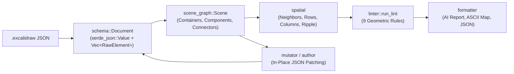

# Architecture and Scene-Graph Reference

## Summary

This reference defines the data model, scene-graph reconstruction rules, spatial track algorithms, and lossless JSON mutation invariants of `excalidraw-spatial`. Developers and AI agents rely on this page to understand how flat Excalidraw JSON elements (`schema::Document`) become semantic containers, components, and connectors (`scene_graph::Scene`), and how layout and authoring operations modify the JSON tree without corrupting untouched fields. For command-line flags, exit codes, and output formats, see [`docs/cli-reference.md`](cli-reference.md).

## Table of Contents

- [Overview](#overview)
- [Contract and Behavior](#contract-and-behavior)
- [Failures and Limits](#failures-and-limits)
- [Further Exploration](#further-exploration)
- [Dev Note](#dev-note)

---

## Overview

Every `excal` command executes a linear pipeline over a `.excalidraw` file (`src/main.rs`):

- **Input**: a UTF-8 `.excalidraw` JSON file (or `-` for `stdin`) containing a top-level object with an `"elements"` array.
- **Core owners**: [`src/schema.rs`](../src/schema.rs) owns JSON parsing and in-place patching; [`src/geometry.rs`](../src/geometry.rs) and [`src/text_metrics.rs`](../src/text_metrics.rs) own primitive geometry and CJK/ASCII text sizing; [`src/scene_graph.rs`](../src/scene_graph.rs) and [`src/spatial.rs`](../src/spatial.rs) own semantic reconstruction and spatial queries; [`src/linter/`](../src/linter/README.md), [`src/mutator/`](../src/mutator/README.md), [`src/author/`](../src/author/README.md), and [`src/formatter/`](../src/formatter/README.md) own the four higher-level subsystems.

---

## Contract and Behavior

Each foundational module enforces explicit invariants on coordinates, JSON serialization, scene hierarchy, and spatial relationships.

### 1. Coordinate System and Numeric Rounding (`src/geometry.rs`)

- **Canvas coordinates**: `x` increases to the right and `y` increases downward, measured in pixels (`f64`).
- **Rectangles**: `Rect { x1, y1, x2, y2 }` always satisfies `x1 <= x2` and `y1 <= y2`. `Rect::overlaps` returns `true` only when both horizontal and vertical overlap depths exceed `0.5px` (edge-touching boxes do not overlap).
- **Segment clipping**: `clip_segment(a, b, r)` implements Liang-Barsky clipping and returns `Some((t0, t1))` within `[0.0, 1.0]` when segment `a -> b` intersects or grazes `r`.
- **`fmt_px(v)`**: rounds half away from zero (`v.round() as i64`) for human/AI text reports, normalizing `-0` to `0`.
- **`ceil_px(v)`**: computes `(v - 1e-6).ceil()` for fix distances and minimum container/text sizes so floating-point noise (such as `208.00000000000006`) never inflates the required shift by an extra pixel.
- **`schema::json_num(v)`**: rounds to two decimal places (`(v * 100.0).round() / 100.0`) and emits a JSON integer when `fract() == 0.0` and `abs() < 9e15`, or a JSON float otherwise.

### 2. Lossless JSON Document and Version Bumping (`src/schema.rs`)

- **Never serialize typed structs back to disk**: `Document` stores the full `serde_json::Value` tree (`preserve_order` and `float_roundtrip` enabled) alongside a read-only `Vec<RawElement>` view. All mutations patch `doc.value["elements"]` in place by element `id` (`set_num`, `set_points`, `set_value`, `insert_element`, `push_element`, `remove_elements`). Untouched elements remain byte-for-byte identical, including key order, float formatting, `index`, and `null` fields.
- **Typed view synchronization**: `doc.refresh()` rebuilds `doc.elements` and `doc.index` from `doc.value["elements"]` without altering `touched` or `created` sets.
- **Pre-existing element version bump (`doc.finish(now_ms)`)**: elements in `touched - created` increment `version` by `1`, advance `versionNonce` via the linear congruential generator `((nonce * 1664525 + 1013904223) & 0x7fffffff).max(1)`, and set `updated = now_ms`.
- **Newly authored element version retention (`doc.finish(now_ms)`)**: elements in `created` keep `version == 1`, their initial FNV-1a `versionNonce`, and `updated = now_ms`, even if they were subsequently resized or moved in the same command or batch.

### 3. Unicode-Aware Text Metrics (`src/text_metrics.rs`)

- **Per-character width estimation (`estimate(text, font_size, line_height)`)**: splits `text` on `'\n'` (`lines = max(count, 1)`) and sums per-character advances for each line (`1.0 * font_size` when `UnicodeWidthChar::width(c) == Some(2)` for CJK/fullwidth forms, and `0.58 * font_size` for all other characters).
- **Dimensions**: returns `TextSize { width: max_line_width, height: lines * font_size * line_height }`.
- **Stored-dimension fallback (`text_size(el)`)**: uses `estimate` whenever stored `width <= 0.0`, `height <= 0.0`, `text` contains `'\n'`, `width < est.width * 0.85`, or `height < est.height * 0.85`; otherwise it preserves the stored `width` and `height`.

### 4. Scene-Graph Reconstruction (`src/scene_graph.rs`)

`Scene::build(&doc)` filters out elements with `isDeleted == true` or type outside `SHAPE_TYPES`, `frame`/`magicframe`, `arrow`/`line`, and `text`, then executes seven steps:

1. **Bind text labels (`containerId`)**: attaches bound `text` elements to their host shape or arrow.
2. **Detect visual zones (`is_zone_rect`)**: identifies background rectangles (`rectangle` with no bound label, or with a top-aligned bound label `verticalAlign == "top"`) that enclose shapes or atomic groups. A candidate child qualifies if its center lies inside `R` and `child.area <= 0.25 * R.area` (`ZONE_CHILD_AREA_RATIO`), or if `R.contains_rect(&child)` and `child.area <= 0.65 * R.area` (`ZONE_CONTAINED_AREA_RATIO`). A rectangle is recognized as a `ContainerKind::Zone` when it has `>= 2` qualifying children, when it has a top-aligned bound label and `>= 1` contained child, or when it has `1` qualifying child (`<= 0.25 * R.area`) plus a free-text title near its top border (`ZONE_TITLE_BAND = 40px`) and no other zone already encloses them. Any Excalidraw `groupIds` wrapper containing a detected zone rectangle (or whose ungrouped shapes enclose `>= 2` contained siblings) is dissolved so the zone becomes a container rather than an opaque icon group.
3. **Build atomic groups (`ComponentKind::Group`)**: merges remaining shapes and free text that share an outermost `groupIds.last()` into a single `Component` with `id = "group:{gid}"` and union bounding box.
4. **Build shapes and absorb inner free text (`ComponentKind::Shape`)**: constructs shape components and absorbs any ungrouped free-text elements whose centers lie inside the shape. If an unlabeled shape absorbs exactly one free-text element (and has no child components), that text becomes the shape's label and records a `NoteKind::UnboundText` note (`INFO UNBOUND_TEXT`).
5. **Claim zone titles and build containers (`Zone` and `Frame`)**: matches each zone rectangle with its top-aligned bound label or highest ungrouped free-text element in the top band (`center.y <= R.y1 + 40px`), and registers explicit `frame`/`magicframe` elements as `ContainerKind::Frame`.
6. **Assign parent hierarchy (`pick_parent`)**: if an item carries `frameId` matching a `Frame` container, its outermost fallback parent is that `Frame`. Among candidate `Zone` containers (`Z.area > item.area` and `Z.contains_point(item.center)`), `pick_parent` prefers zones that **fully contain** `item.rect` (`Z.contains_rect(&item.rect)`) over zones that only contain `item.center`, picking the smallest-area zone (ties broken by lower `z`). This prevents an adjacent overlapping sibling zone from stealing a child that is fully enclosed by its own zone.
7. **Build connectors (`Connector`)**: converts relative `points` into canvas `Point`s, resolves `start` and `end` attachments (`Attach::Bound` via `startBinding`/`endBinding`, `Attach::Near` within `NEAR_DIST = 12px` when at least one segment is `>= 20px`, or `Attach::Free`), and computes bound arrow `label_rect`.

### 5. Target Query Resolution (`Scene::resolve`)

`scene.resolve(query)` matches a user string against components, containers, and connectors in four priority steps:

1. **Exact semantic ID**: matches `Component.id`, `Container.id`, or `Connector.id`.
2. **Member raw element ID**: matches any raw element ID in `Component.elements` or `Container.elements`.
3. **Exact trimmed label/name**: matches `Component.label.trim() == query.trim()` or `Container.name.trim() == query.trim()`.
4. **Collapsed single-line `inline_text` fallback**: matches `inline_text(label) == inline_text(query)` so multi-line labels can be referenced by their single-line `excal inspect` text.

If step 3 or 4 matches multiple objects, `resolve` returns an ambiguity error listing the candidate IDs in ascending `z` order (`ambiguous label "{query}": matches id1, id2`).

### 6. Spatial Corridor Neighbors, Obstacle-Split Tracks, and Ripple (`src/spatial.rs`)

- **4-way corridor neighbors (`neighbors`)**: for a non-`Text` component `me`, filters non-`Text` components whose vertical projection overlaps `me.rect` (`min(y2) - max(y1) > 0.5`) to find the nearest left (`c.x2 <= me.x1 + 0.5`) and right (`c.x1 >= me.x2 - 0.5`) neighbors, and symmetrically along horizontal projection for top and bottom neighbors.
- **Running-intersection track clustering (`rows_with_obstacles`, `columns_with_obstacles`)**: clusters sibling non-`Text` components (`c.parent == parent`) using a running intersection band `[band_lo, band_hi]` so a tall sidebar cannot bridge two separate rows into one cluster.
- **Orthogonal column splitting**: splits candidate horizontal rows at any member that belongs to a `>= 2` vertical column unless every member of the row also belongs to a vertical column (preserving true grids while preventing stacked column nodes from merging into a single row).
- **Sibling container obstacle splitting (`B21`)**: splits tracks whenever a sibling container (`sibling_container_rects(scene, parent)`) intersects the span and shared cross-axis band between two adjacent track members.
- **Downstream ripple targets (`ripple_targets`)**: given a dominant horizontal (`|dx| >= |dy|`) or vertical (`|dy| > |dx|`) move on `anchor`, returns all sibling non-`Text` components and sibling containers whose cross-axis projection overlaps `anchor.rect` and whose center lies strictly downstream of `anchor.rect.center()` along the move direction.

---

## Failures and Limits

- **Malformed JSON input**: `Document::parse` rejects inputs that are not valid JSON objects or lack an `"elements"` array with an error (`exit code 2` in the CLI). Individual elements inside `"elements"` that fail `RawElement` deserialization are skipped with `excal: warning: skip element #{i}: {err}` on `stderr`.
- **Unresolved or ambiguous target queries**: `Scene::resolve` fails when no object matches (`cannot resolve "{query}"`) or when a label matches multiple objects (`ambiguous label "{query}": matches ...`).
- **Geometric scope limits**: rotation angles (`angle != 0`) are ignored; curved arrows are approximated by their polyline vertices; `freedraw` and `selection` elements are ignored.

---

## Further Exploration

- [`docs/cli-reference.md`](cli-reference.md): CLI subcommands, flags, exit codes, and JSON/text schemas.
- [`docs/authoring-tutorial.md`](authoring-tutorial.md): step-by-step workflow for authoring and laying out a diagram.
- [`src/linter/README.md`](../src/linter/README.md): the 9 geometric lint rules built on `Scene` and `spatial`.
- [`src/mutator/README.md`](../src/mutator/README.md): layout planning, `retain_zone_membership`, and connector re-sync.
- [`src/author/README.md`](../src/author/README.md): deterministic element synthesis and batch script execution.
- [`src/formatter/README.md`](../src/formatter/README.md): AI inspect report, ASCII minimap, and JSON formatters.

---

## Dev Note

None.
